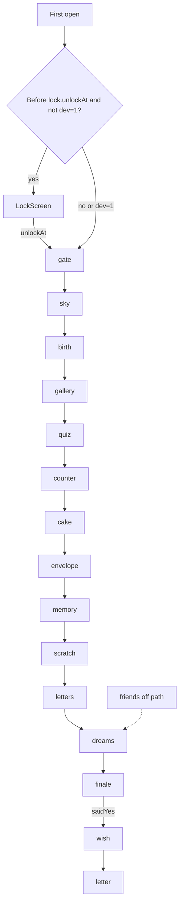

# Bàn giao cho ChatGPT — MJ Universe

Tài liệu này tự đủ để dán vào một phiên mới. Không cần mở các file audit khác để hiểu bức tranh. Chi tiết dòng code nằm ở `docs/story-review/` nếu phiên đó có repo.

Không ghi giá trị `gate.password`. Key là `site/content.json` → `gate.password`.

## Tóm tắt

MJ Universe (`package` `vu-tru-cua-em`) là một trang sinh nhật một đường cho MJ. Trước `2026-11-18T00:00:00+07:00` chỉ có countdown. Sau đó: cửa tên, bầu trời 7 sao, chart sao buổi sinh, galaxy ảnh, quiz, đồng hồ, bánh, phong bì, pairs, thẻ cào, thư “mở khi”, ước mơ, câu Có/Không, ước của MJ, thư cuối.

Parker là người quyết định sản phẩm. Implementation nằm trong repo này. Giọng muốn có: lãng mạn nhưng tự nhiên, tinh nghịch, không thơ quá, giữ humor riêng, dồn tới một lá thư cuối có trọng lượng.

Stack thật: React 19, TypeScript ~6, Vite 8, Framer Motion 14, CSS một file, WebGL1 tự viết cho galaxy, canvas 2D, Cloudinary, `localStorage`, Vercel static. Không React Router, không backend.

## Fact triển khai

- Giờ sinh **đã xác nhận** và **đã gắn đúng**: `content.birth.when` = `2002-11-18T16:45:00+07:00`. `selfcheck.mjs` assert chuỗi và chuỗi hiển thị `16:45`. Đừng đề xuất sửa giờ này.
- Ngày bắt đầu quan hệ: `content.startDate` = `2026-07-01T00:00:00+07:00`. Mọi `eras[].date` cùng ngày đó. Validator từ chối era có `date` sớm hơn `startDate` (`site/src/content.ts`).
- Ngày gặp lần đầu `2022-11-18`: **không có trong repo** (không có chuỗi `2022`). Không bị một ngày “gặp nhau” khác phủ định. Đang thiếu.
- Khóa trang là nửa đêm 18/11/2026 UTC+7 (`lock.unlockAt`), không phải 16:45. 16:45 chỉ cho chart sao.
- `FLOW` khi `INCLUDE_FRIENDS = false` (`site/src/lib/flow.ts`): 15 id `gate sky birth gallery quiz counter cake envelope memory scratch letters dreams finale wish letter`. Cộng màn `LockScreen` trước `gate`.
- `friends` có component và 8 note nhưng không trên path. Dev jump không có nút friends.
- 7 sao (`STAR_LAYOUT`) là hoạt cảnh, không phải menu. `chapters[].star` không được render.
- Next ẩn đến khi `stepDone`, **trừ** `sky`, `counter`, `friends` (luôn true). `gate` tự chuyển. `letter` không có Next.
- Gallery xong khi xem **một** era tới ảnh cuối. 39 ảnh, caption trống, compliment có.
- Pairs lấy 6 ảnh pair đầu, không phải mọi era.
- Scratch xong khi cào hơn ~46% foil. Quiz sai vẫn được đi tiếp.
- Nến: mic RMS > 0.11 hoặc tap. Bánh có 5 nến.
- Open-when: 4 thư, mở hết là qua. Không khóa “một lần mỗi ngày” trong UI dù có lưu ngày.
- Nút Không trên finale không bao giờ được chọn. Có thì pháo hoa.
- Wish tối đa 180 ký tự, lưu trong `lilj.progress.v1` (tối đa 24).
- Nhạc: playlist ngẫu nhiên, muted lần đầu, toast 3 giây + ring trên nút đến khi phát được. Cake crossfade bài birthday. Letter `fadeMusic(8000)`. SFX duy nhất là `playChime` lúc ước, và chỉ khi nhạc đang phát.
- Locale `lilj.locale.v1`, mặc định `en`. Copy `{vi,en}`.
- Ảnh Cloudinary public id `lilj/...`, transform `c_limit` + `f_auto` + `q_auto`.

## Luồng điều hướng



`?dev=1` bỏ khóa và nhảy bước. `?dev=1&lock=1` giữ countdown đến đúng giờ.

## Ràng buộc khi đề xuất

- Mọi chữ MJ đọc nên ở `site/content.json`, cả `vi` và `en`. Đừng nhét câu mới vào TSX.
- Đừng đổi `birth.when`. Đừng in `gate.password`.
- iPhone 14 Pro Max là khung chính: 430×932 và 430×739 khi toolbar trình duyệt chiếm chỗ. Safe area phone rộng trong overlap script: top 59px, bottom 34px. CSS dùng `env(safe-area-inset-*)`.
- Sở thích hình Parker đang có trong CSS: font system (`--sans`), không italic, bo góc, scale chữ compact (`--text-body` 14px, `--text-h1` 24px), reveal từng từ, chữ nét (không blur trừ transition cảnh). Next nên ẩn đến khi bước xong. Đề xuất nào phá các thứ này cần nói rõ.
- Ảnh mới là public id Cloudinary, không commit file. Nhạc mới là file trong `site/public/music` cộng một object trong `music.tracks`.
- Thêm/bớt bước `FLOW` phải kèm `migrateIndex` / `FLOW_VERSION` vì save cũ lưu index.
- `era.date` không được sớm hơn `startDate` trừ khi sửa `validateContent`.
- Reduced motion phải vẫn chơi được.
- Không thêm framework.

## Câu hỏi còn mở

- Copy nào sẽ nói về 2022-11-18, và ảnh nào thuộc giai đoạn đó? Repo chưa có.
- Sáu thẻ cào hiện tại đã là “sáu điều anh thích” chưa, hay cần viết lại `cover`/`reveal`? Cần đọc nội dung `scratches` (không suy từ số 6).
- Lời mời hẹn hò là một câu trong `finale` hay một cảnh mới? Code không có cảnh date.
- Bạn bè có lên path không? Flag đang tắt.
- Bản quyền các mp3 (Laufey, beabadoobee, sleepvolume, piano, music box). Code không chứng minh license.
- `finalLetter` nên đóng dấu ngày sinh (đang vậy) hay ngày khác?
- Gallery nên bắt xem hết era hay giữ “một era là đủ”?

Không còn giả định “giờ sinh chưa kiểm”. Giờ sinh đã kiểm.

## File nên đọc tiếp

| File | Vì sao |
| --- | --- |
| `site/src/lib/flow.ts` | Thứ tự cảnh và điều kiện Next |
| `site/src/App.tsx` | Khóa, map component, nhạc, toast, reset |
| `site/content.json` | Toàn bộ chữ. Nhớ không dán `gate.password` vào chat công khai |
| `site/src/content.ts` | Luật validator, pair ảnh, Cloudinary id |
| `site/src/lib/pure.ts` | 7 sao, so khớp tên, template |
| `site/src/components/BirthSky.tsx` | Chart và 4 note |
| `site/src/components/Finale.tsx` | Nút Có/Không |
| `site/src/components/FinalLetter.tsx` | Nhịp thư cuối và fade nhạc |
| `site/src/styles.css` dòng 1–66 | Token hình |
| `docs/story-review/STORY_UX_AUDIT.md` | P0/P1 đã tách fact và đề xuất |

## Gói nguồn gợi ý

Chưa tạo gói này. Lệnh dưới đây chỉ để người đọc chạy khi cần. Loại `node_modules`, `dist`, font nhị phân, mp3, và xóa password trước khi đưa file ra khỏi máy.

```bash
mkdir -p /tmp/mj-universe-src/site
rsync -a \
  --exclude node_modules --exclude dist --exclude '*.mp3' --exclude '*.woff2' --exclude '*.wav' \
  site/src site/index.html site/package.json site/vite.config.ts site/vercel.json \
  /tmp/mj-universe-src/site/
node --input-type=module -e '
import { readFileSync, writeFileSync } from "node:fs";
const data = JSON.parse(readFileSync("site/content.json", "utf8"));
data.gate.password = "[redacted]";
writeFileSync("/tmp/mj-universe-src/site/content.redacted.json", JSON.stringify(data, null, 2));
'
tar -C /tmp -czf /tmp/mj-universe-src.tgz mj-universe-src
```

Đừng commit `content.redacted.json` hay file `.tgz`.
