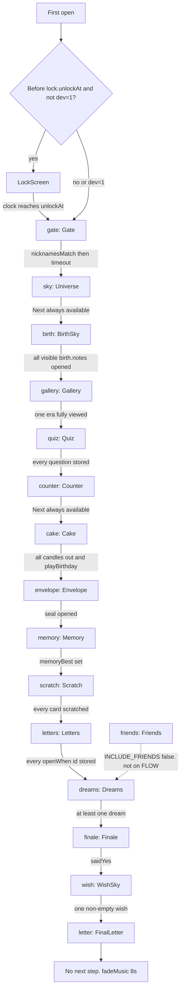

# Hành trình người dùng

Nguồn sự thật là `FLOW` trong `site/src/lib/flow.ts` dòng 4–23 với `INCLUDE_FRIENDS = false` (dòng 1). Có **15 cảnh tuần tự** sau khi cổng thời gian mở, cộng **1 màn khóa** trước đó. Không có hub. Không có menu chương.

`friends` là hoạt động **đã code nhưng không gắn path** (**Partial**). Các lớp trong một cảnh (stack ảnh, sheet thư, toast nhạc, dialog reset) không phải cảnh riêng.

## Trước mọi cảnh: khóa sinh nhật

| | |
| --- | --- |
| ID | không có trong `FLOW`. Key render `"lock"` (`App.tsx` dòng 451) |
| Component | `LockScreen` (`site/src/components/LockScreen.tsx`) |
| Vào | `isBeforeUnlock(content.lock.unlockAt)` và không bypass (`App.tsx` dòng 63–65, `site/src/lib/lock.ts` dòng 10–14) |
| MJ thấy | `lock.title`, `lock.subtitle`, đồng hồ ngày/giờ/phút/giây (`LockScreen.tsx` dòng 142–156) |
| Làm được | Không nhập, không Next. Chờ. `setInterval` 1s và timeout tới đúng mốc (dòng 105–107). Hết giờ gọi `onOpen` → `setReleased(true)` |
| Nhạc | Không. Header nhạc chỉ khi `released && progress.gateUnlocked` (`App.tsx` dòng 389) |
| Persist | Không ghi progress trên màn này |
| Status | **Implemented** |

`lock.unlockAt` = `2026-11-18T00:00:00+07:00` (nửa đêm ngày sinh, UTC+7). Giờ sinh 16:45 **không** dùng cho khóa này. Khóa là nửa đêm, chart sao dùng 16:45. Hai mốc khác nhau, cùng ngày, cả hai có trong data. Không mâu thuẫn nếu hiểu: trang mở lúc 00:00, bầu trời vẽ lúc 16:45.

`?dev=1`: bỏ khóa, hiện hàng số 1…15 và nút `×` xóa `lilj.progress.v1` rồi reload (`App.tsx` dòng 420–442). `?dev=1&lock=1`: vẫn khóa đến đúng giờ, hàng số ẩn vì `released` false.

## Bảng cảnh chính

Cột Next là bước `go(step + 1)` khi `stepDone` true, trừ chỗ ghi riêng. Content key viết tắt từ `site/content.json`.

| Order | Scene ID | Component | Entry condition | Interaction | Next scene | Content keys | Status |
| --- | --- | --- | --- | --- | --- | --- | --- |
| 0 | `lock` | `LockScreen` | Trước `lock.unlockAt`, không `?dev=1` | Chỉ xem countdown | `gate` khi hết giờ | `lock.*` | Implemented |
| 1 | `gate` | `Gate` | `released` và `step === 0` | Gõ biệt danh, submit | Tự sang `sky` sau 2100ms (800ms nếu reduced motion). Không có Next | `gate.question`, `subtitle`, `placeholder`, `submit`, `empty`, `hints[]`, `found`, `welcome`, `meta.title`; so với `gate.password` | Implemented |
| 2 | `sky` | `Universe` | `step` 1, thường sau gate | Xem 7 sao tự nối. Không bấm sao | `birth` qua Next. `stepDone("sky")` **luôn true** (`flow.ts` dòng 99–102) nên Next có ngay, không đợi animation | `meta.herName`, `meta.title`, `meta.constellationName`, `ui.waiting`, `ui.formed` | Partial |
| 3 | `birth` | `BirthSky` | `step` 2 | Chạm từng chòm trong `birth.notes` (4 id: `cas`, `lyr`, `cyg`, `aql`) | `gallery` khi `birthSeen` (`flow.ts` dòng 103–104). `onSeen` khi mở đủ note hiện trên trời (`BirthSky.tsx` dòng 93–98) | `birth.*`, `constellations.*` | Implemented |
| 4 | `gallery` | `Gallery` + `SpiralGalaxy` | `step` 3 | Bay vào era, flick stack, lật mặt, fullscreen | `quiz` khi `erasViewed.length > 0` (`flow.ts` dòng 105–106). Một era xem tới ảnh cuối là đủ (`Gallery.tsx` dòng 649–656) | `chapters[gallery]`, `eras[]`, `galleryCopy.*` | Implemented (điều kiện hoàn thành là một era, không phải cả năm) |
| 5 | `quiz` | `Quiz` | `step` 4 | Chọn 1 đáp án / câu, 5 câu `q1`–`q5`. Sai vẫn khóa và hiện `wrongNote` | Sticky “câu tiếp” trong quiz. Next sang `counter` khi mọi id có số trong `progress.quiz` (`flow.ts` dòng 107–108), kể cả sai | `quiz[]`, `quizSummary`, `quizMarks`, `ui.nextQuestion`, `ui.summaryTitle`, `ui.seeAgain` | Implemented |
| 6 | `counter` | `Counter` | `step` 5 | Xem đồng hồ từ `startDate` | `cake`. `stepDone("counter")` luôn true (dòng 99–102). `counterSeen` chỉ set sau 2s (`App.tsx` dòng 120–126) và **không** chặn Next | `chapters[counter]`, `together.past` / `future` / `until`, `ui.unit*` | Partial |
| 7 | `cake` | `Cake` | `step` 6 | Tắt 5 nến bằng mic (RMS > 0.11) hoặc tap. Thư typewriter | `envelope` khi mọi nến nằm trong `candlesOut` (`flow.ts` dòng 109–112) | `cake.*` | Implemented |
| 8 | `envelope` | `Envelope` | `step` 7 | Chạm seal | `memory` khi `envelopeOpened` | `envelope.*` | Implemented |
| 9 | `memory` | `Memory` | `step` 8 | Lật 2 lá. 6 cặp từ 2 ảnh đầu mỗi era, `slice(0, 6)` (`Memory.tsx` dòng 18–19) | `scratch` khi `memoryBest != null` (thắng một lần) | `chapters[memory]`, `memoryCopy.*`, ảnh `pair` | Implemented |
| 10 | `scratch` | `Scratch` | `step` 9 | Cào foil. Xong khi > 46% mẫu alpha < 40 (`Scratch.tsx` dòng 205–222) | `letters` khi mọi `scratches[].id` nằm trong `scratched` | `chapters[scratch]`, `scratches[]` (6 thẻ) | Implemented |
| 11 | `letters` | `Letters` | `step` 10 | Mở từng thư. Sheet modal | `dreams` khi mỗi `openWhen` id đã có ngày trong `progress.openWhen` | `lettersCopy.*`, `openWhen[]` (`sad`, `miss`, `angry`, `awake`) | Implemented. Không khóa theo ngày: mở một lần là `seen` mãi (`Letters.tsx` dòng 46) |
| 12 | `dreams` | `Dreams` | `step` 11 | Tick ít nhất một ước | `finale` khi `dreamsDone.length > 0` | `chapters[dreams]`, `dreams[]` (7) | Implemented |
| 13 | `finale` | `Finale` | `step` 12 | Nút Có ghi `saidYes`. Nút Không nhảy khỏi pointer (`Finale.tsx` dòng 84–88), không chọn được | `wish` khi `saidYes` | `finale.*` | Implemented (Không là tease, không phải lựa chọn) |
| 14 | `wish` | `WishSky` | `step` 13 | Gửi một câu, tối đa 180 ký tự (`WishSky.tsx` dòng 274) | `letter` khi có wish text không rỗng | `wish.*` | Implemented |
| 15 | `letter` | `FinalLetter` | `step` 14 | Đọc từng token, skip, replay | Không có cảnh sau. `stepDone` khi `letterDone`. Next bị cấm (`App.tsx` dòng 269) | `finalLetter.*`, `ui.dottedDate`, `ui.startOver` | Implemented |

Thứ tự thực tế **không** phải “quiz rồi mới tới ảnh”, và **không** gom bánh với thư “mở khi”. Bánh đứng trước phong bì, pairs, scratch, rồi mới tới thư.

## Phân loại

**Tuần tự chính:** `lock` rồi 15 id ở bảng. Một `stepId` một lúc (`AnimatePresence`, `App.tsx` dòng 448–476).

**Hub / 7 sao:** **Planned-not-implemented** dưới dạng điều hướng. `STAR_LAYOUT` (`site/src/lib/pure.ts` dòng 93–101) có đúng 7 điểm `memory`, `friends`, `quiz`, `counter`, `dreams`, `scratch`, `gallery`, nối thành vòng kín quanh `constellationName` (`Universe.tsx` dòng 61–80). Chúng không nhận click, không `go()`. `chapters[].star` có trong JSON và `types.ts` dòng 22 nhưng không component nào render field đó.

**Hoạt động optional trong cảnh:**

- Gallery: era chưa xem, flip, `Fullscreen` (`Gallery.tsx` dòng 438). Không bắt buộc để qua bước, ngoài việc xem **một** era tới ảnh cuối.
- Quiz: `seeAgain` quay về câu 0 (`Quiz.tsx` dòng 89–91).
- Memory: `again()` (`Memory.tsx` dòng 76).
- Letters: mở lại thư đã đọc.
- Wish: gửi thêm (mảng `wishes`, cắt 24 phần tử ở `App.tsx` dòng 112).
- Final letter: replay và “làm lại” mở dialog reset.
- Nhạc: bật/tắt bất cứ lúc nào sau gate.

**Modal / overlay:**

- Reset confirm (`App.tsx` dòng 507–525), từ nút header hoặc thư cuối.
- Sheet thư `openWhen` (`Letters.tsx` dòng 63–79).
- Toast `musicBlocked` (`App.tsx` dòng 528–531).
- `GateBurst` khi `opening` (dòng 527).
- Hint `music-hint` trước khi toast chặn nhạc từng hiện (`App.tsx` dòng 414–417).

**Unlockable:** không có nhánh mật. Mở khóa duy nhất là (1) hết countdown hoặc `?dev=1`, (2) `gate.password` qua `nicknamesMatch` (`pure.ts` dòng 5–7: NFC, trim, gộp space, `toLocaleLowerCase("vi")`). Sai thì xoay `gate.hints`, không hiện password (`Gate.tsx` dòng 48–54).

**Final sequence:** `finale` (Có) → `wish` → `letter`. Nhạc nhỏ dần 8s trên `letter`. Không có cảnh chòm sao kết sau thư. Chòm sao tên MJ nằm ở `sky`, sớm trong path.

## Skip và quay lại

- Skip cả đường: chỉ `?dev=1` + `go(index, true)`.
- Trong cảnh: skip typewriter bánh (`cake.skip`), skip thư cuối (`finalLetter.skip`). Reduced motion bỏ delay.
- Back một bước: nút `←`, `go(step - 1)` không jump, nên không vượt quá `unlocked`.
- Reload: `useProgress` đọc `lilj.progress.v1`, `migrateIndex` nếu `flowVersion` cũ (`flow.ts` dòng 55–68). Bản lưu đang đứng ở `friends` được đưa tới `dreams`.

## Âm thanh và hiệu ứng theo cảnh

| Cảnh | Animation | Âm thanh |
| --- | --- | --- |
| `lock` | Reveal + reel số. Framer trên từng digit (`LockScreen.tsx` dòng 15–26) | Không |
| `gate` | Reveal, shake 480ms khi sai (`Gate.tsx` dòng 27–31), burst khi đúng | `startMusic(progress.muted)` trong `unlock()` (`App.tsx` dòng 255). Lần đầu muted nên thường không phát |
| `sky` | Sao sáng mỗi 320ms, nét vẽ 2.6s, tên sau đó (`Universe.tsx` dòng 28–34, 56) | Playlist chỉ nếu đã unmute |
| `birth` | Layout sao tĩnh + chọn chòm | Playlist |
| `gallery` | WebGL spin; reduced motion thì đứng (`galaxy-gl.ts`) | Playlist |
| `cake` | Nến, confetti nếu không reduced (`Cake.tsx`) | `playBirthday` crossfade |
| `finale` | `Hearts` + `Fireworks` khi `saidYes` (`Finale.tsx` dòng 63–64) | Playlist (đã rời cake nên `resumePlaylist` đã chạy khi unmount cake) |
| `wish` | Sao bay trên canvas; `playChime` nếu nhạc đang phát | Chime phụ thuộc playlist |
| `letter` | Token ~46–50ms (`FinalLetter.tsx` `delayFor` dòng 171–177), `fadeMusic(8000)` | Playlist hạ volume |

## Persist

`lilj.progress.v1`: `step`, `unlocked`, `gateUnlocked`, `skyDone`, `birthSeen`, `flippedPhotos`, `erasViewed`, `quiz`, `counterSeen`, `candlesOut`, `envelopeOpened`, `memoryBest`, `scratched`, `openWhen`, `friendsSeen`, `dreamsDone`, `saidYes`, `wishes`, `letterDone`, `muted`, `flowVersion`. Định nghĩa `emptyProgress` (`progress.ts` dòng 6–31).

`friendsSeen` được set nếu `stepId === "friends"` (`App.tsx` dòng 128–134) nhưng step đó không lên path hiện tại.

## Flowchart

`?dev=1` nhảy tới bất kỳ id nào trên `FLOW` và nâng `unlocked`. Không vẽ hết các cạnh đó cho đỡ rối.
